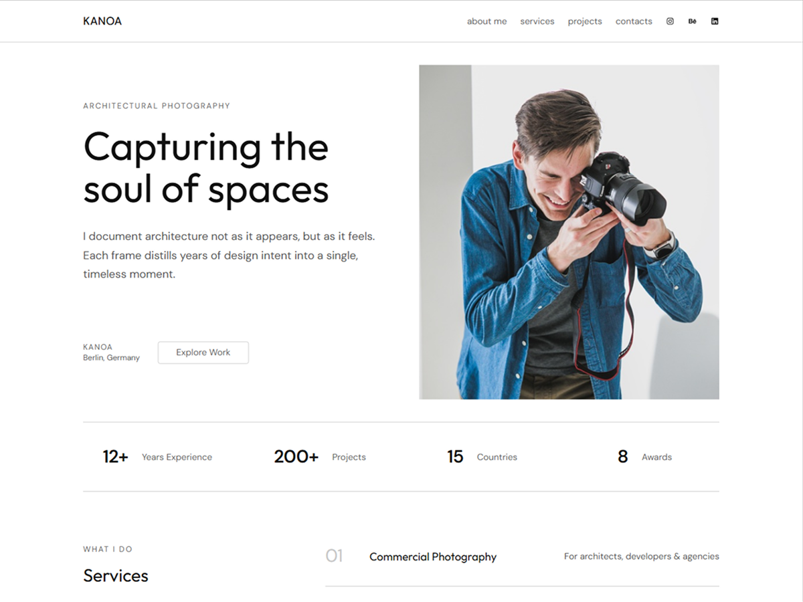

# Kanoa

  

Kanoa is a refined, minimalist portfolio theme designed for photographers, architects, designers, and creative professionals who value clean aesthetics and purposeful design. Built entirely with the WordPress Site Editor, this theme offers complete creative control without writing code.

- **WordPress.org:** https://wordpress.org/themes/kanoa/
- **Live preview:** https://wp-themes.com/kanoa/

## Installation

1. Check you version of WordPress, it should be 6.7 or later.
2. Upload the theme.
3. Activate the theme.

To install the development version from this repository, download it as a ZIP (Code > Download ZIP), rename the folder inside to `kanoa` and upload it in Appearance > Themes > Add New Theme > Upload Theme.

## Requirements

- WordPress 6.7 or later
- Tested up to WordPress 7.1
- PHP 7.4 or later

## Changelog and credits

The full changelog, image and font credits with their licenses are listed in [readme.txt](readme.txt).

## License

Kanoa is distributed under the terms of the [GNU General Public License v2 or later](https://www.gnu.org/licenses/gpl-2.0.html).

---

More themes by Roman Fink: https://wordpress.org/themes/author/romanfink/
